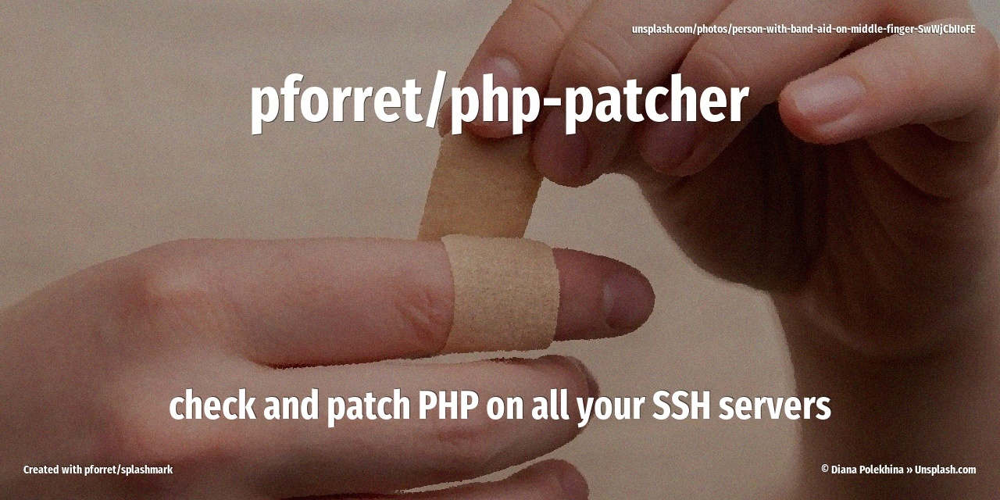

# pforret/php-patcher



Check — and optionally patch — the PHP version (CLI and every PHP-FPM) on all your SSH servers.

> **TL;DR** — rather not run a script on your machine? [docs/DIY.md](docs/DIY.md) has the handful of
> commands it boils down to: check your PHP versions and patch them by hand, on Linux, macOS or Windows.

For each server it prints the OS and every PHP binary with a status:

- `OK` — at or above the first fixed release of its branch
- `PATCH (fixed in x.y.z)` — below it: upgrade
- `EOL (no PHP fix for 8.1)` — a branch that no longer gets fixes

```text
% php-patcher --pick --patch auto
Patch PHP on 1 host(s): web1 ? [y/N] y 
sudo password for forge@web1 (empty = skip):                                                                                                                                                        
web1  Ubuntu 24.04.4 LTS                                                                                                                                                                            
  php (cli)      8.4.26   PATCH (fixed in 8.4.27)  released 2026-09-24, 27 days ago
  php-fpm8.3     8.3.35   PATCH (fixed in 8.3.36)  released 2026-09-24, 27 days ago
  php-fpm8.4     8.4.26   PATCH (fixed in 8.4.27)  released 2026-09-24, 27 days ago
  apt: upgrading 51 php packages
  restarted php8.3-fpm.service
  restarted php8.4-fpm.service
  after upgrade:
  php (cli)      8.4.27   OK  released 2026-10-21, today
  php-fpm8.3     8.3.36   OK  released 2026-10-21, today
  php-fpm8.4     8.4.27   OK  released 2026-10-21, today
```

## Install

```bash
git clone https://github.com/pforret/php-patcher.git
cd php-patcher
./php-patcher.sh install   # symlink in your PATH + bash/zsh completion
```

## Usage

```bash
php-patcher host web1                 # one server
php-patcher host web1,web2,web3       # several servers (comma-separated)
php-patcher file hosts.txt            # one host per line, # comments ok
php-patcher auto                      # every Host in ~/.ssh/config (and its Include files)

php-patcher -l auto                   # only list the hosts that would be used
php-patcher -I forge auto             # only hosts matching a regex (--include forge, no "=")
php-patcher -x 'pi|nas|^old-' auto    # skip hosts matching a regex
php-patcher --pick auto               # choose 1 host from the list (fzf, gum or a numbered menu)

php-patcher --patch host web1         # upgrade PHP packages, restart php-fpm, show versions again
php-patcher -f --patch auto           # patch everything without asking
```

Flags go **before** the verb (`php-patcher --patch auto`, not `php-patcher auto --patch`).

`auto` skips wildcard and negated `Host` patterns, git hosts (github.com, gitlab.com, bitbucket.org, …)
and aliases of a server that is already in the list (same HostName and Port).

The exit code is 1 when one or more hosts failed (ssh error or upgrade error). A host that
was upgraded but is still below `--fixed` only counts as failed after `--released`: before that,
it is listed as "only got the previous patch", to patch again later.

## Fixed versions

The OK/PATCH status compares against `--fixed` (default `8.5.12 8.4.27 8.3.36 8.2.35`,
the **expected** releases of 21 Oct 2026). Check them against
<https://www.php.net/archive/2026.php> before trusting the status column, and override them with
`-F "8.5.12 8.4.27 8.3.36 8.2.35"` or in a `.env` file next to the script.
Set `--released` (default `2026-10-21 14:00`, UTC) to when they come out: before that moment the
script warns that no host can get them yet.

```bash
fixed="8.5.12 8.4.27 8.3.36 8.2.35"
released="2026-10-21 14:00"
exclude="pi|nas"
include="forge"
```

## Requirements

- `ssh` and `awk` locally; `fzf` (optional) for `--pick`
- every host name resolves via `~/.ssh/config`, with key-based login (BatchMode, no passwords)
- for `--patch`: `sudo` on the server (without a password, or you get asked for it; with `-f` or
  without a terminal it prints the `ssh -t` command to run yourself), and apt (Debian/Ubuntu, incl. the Ondřej Surý
  packages used by Forge) or dnf/yum (RHEL/Alma/Rocky, Remi)

## Ubuntu 20.04: upgrade-ubuntu.sh

No PHP repository builds PHP 8.x for Ubuntu 20.04 anymore, so on such a server `--patch` can't help.
`upgrade-ubuntu.sh` scripts the in-place upgrade 20.04 → 22.04 → 24.04 over SSH, one verb per stage:

```bash
./upgrade-ubuntu.sh password myhost     # once, in your terminal: sudo password, stored encrypted
./upgrade-ubuntu.sh status myhost       # where does the upgrade stand, what is next (read-only)
./upgrade-ubuntu.sh nginx-down myhost   # sites offline until nginx-up
./upgrade-ubuntu.sh preflight myhost    # read-only READY / BLOCKED report
./upgrade-ubuntu.sh prepare myhost      # backups, DB dump, mirror fix, apt full-upgrade
./upgrade-ubuntu.sh upgrade myhost      # in your terminal: do-release-upgrade inside screen
./upgrade-ubuntu.sh postflight myhost   # after the reboot: PHP back from ppa:ondrej/php
./upgrade-ubuntu.sh nginx-up myhost     # then verify and cleanup
```

Every verb ends with `STATUS:` and `NEXT:` lines and keeps a log in `~/log/upgrade-ubuntu/<host>/`,
so it can also be driven with Claude Code. See [docs/faq/ubuntu20.md](docs/faq/ubuntu20.md#scripted-upgrade-ubuntush).

## Troubleshooting

- [docs/DIY.md](docs/DIY.md): the same checks and patches by hand, without this script (Linux, macOS, Windows)
- [docs/faq/ondrej.md](docs/faq/ondrej.md): Ondřej's PHP/nginx/apache2 repositories (403, Ubuntu 20.04, release lag)
- [docs/faq/apt.md](docs/faq/apt.md): obsolete apt sources, expired keys, `Unmet dependencies`
- [docs/faq/ubuntu20.md](docs/faq/ubuntu20.md): upgrading an Ubuntu 20.04 server to 22.04 or 24.04 (no PHP 8.x packages left for focal)

## Tests

```bash
bats tests/    # both scripts, offline: fake ssh/fzf/security and a temporary HOME, no server is contacted
```

Built with [bashew](https://github.com/pforret/bashew).
